# MSI forced installation and restoration

## MSI behavior

For a new installation, if the registry search detects an existing eBPFCore service `ImagePath`,
the MSI stops unless `FORCE=1` is supplied.

With `FORCE=1` and an existing eBPFCore registration, the MSI:

1. Saves the current configuration and running state of eBPFCore, NetEbpfExt, and eBPFSvc.
2. Stops NetEbpfExt, eBPFSvc, and then eBPFCore.
3. Preserves the existing Windows binaries through backup hard links and replaces their canonical
   Windows paths with hard links to the new MSI binaries.
4. Saves the HKLM and installing user's HKCU eBPF stores, then replaces their metadata with the MSI's version.
5. Configures and starts the drivers, and configures and requests startup of eBPFSvc.

The MSI saves one original backup set for both failed-install recovery and final uninstall.
Only uninstall creates additional, temporary recovery snapshots.

On final uninstall, the saved original service state, binary hard links, and HKLM store are used
to restore the machine-wide eBPF stack to its pre-MSI state. HKCU restoration is best effort by identity:
only the saved installing user restores their HKCU store. Another user or SYSTEM skips that restoration
with a warning, leaves the caller's HKCU unchanged, and retains the original HKCU backup. If no saved
HKCU identity exists, the caller's store is also left unchanged. Other restoration errors remain fatal.
The same ownership check gates HKCU backup, clear, and population during installation: a different user
does not change their HKCU store while another user's backup area is retained.

### One original backup, plus temporary uninstall undo

The supported version-change workflow is uninstall, then install; in-place upgrades are disallowed.
**Original backups** preserve the inbox stack before forced installation. A failed install restores
that same backup and removes it after recovery. A successful install retains it until final uninstall.
There is no second initial-install snapshot and no install-time backup cleanup commit.

Each backup action rejects existing backup/staging data rather than reusing or overwriting it.
MSI registers that action's rollback only after the backup succeeds, before changing the live state.
A rejected backup therefore cannot cause rollback to consume a snapshot from an earlier attempt.
Partial backup failures clean up only their newly created files; interrupted or failed recovery may
leave data that an administrator must investigate before retrying.

**Uninstall rollback snapshots** preserve the current MSI service and registry state before removal.
For example, with original stack **A** replaced by MSI stack **B**, successful uninstall restores **A**.
If uninstall fails after partially restoring **A**, these temporary snapshots and the MSI binaries
recover **B**. They do not replace the original backup of **A**.

### Requirements and recovery details

New installations are rejected if NetEbpfExt's or eBPFSvc's `ImagePath` is detected without an eBPFCore `ImagePath`,
even with `FORCE=1`. Maintenance and uninstall remain allowed.

Forced replacement uses NTFS hard links for six binaries under `System32` and `System32\drivers`,
and updates service registrations to those canonical Windows paths. `INSTALLFOLDER` must be on the
same volume as Windows and support hard links. Missing canonical binaries, failure to stop a service,
or failure to stage replacement links aborts replacement before any canonical link is changed.

The standard MSI service-stop action is skipped for forced stack replacement so the custom chain can
capture running states before stopping services. Normal installation, maintenance, and uninstall
retain standard service stopping. The installer temporarily grants access to protected originals and
restores their ACLs through the original backup links; distinct replacement files retain their MSI-installed ACLs.
Service restoration preserves service and load-order-group dependencies and restores an absent
`ServiceSidType` to its default, `none`. Uninstall rollback stops restored services before relinking
the MSI binaries. Missing canonical links are recreated from the MSI files while retaining original
backups; a failure on one mapping does not prevent recovery attempts on the others.

Success-only cleanup failures are logged but do not trigger rollback after other cleanup actions have
already deleted recovery data.

### Backup filenames

Service and HKLM store metadata reside under `%ProgramData%\eBPF-for-Windows\MsiBackup`.
HKCU snapshots reside in its `UserStore` subdirectory.
In the table, `<scope>` is `hklm` or `hkcu`, and `<service>` is eBPFCore, NetEbpfExt, or eBPFSvc.

| State | Metadata | Registry export |
|---|---|---|
| Original store | `ebpf-store-<scope>.json` | `ebpf-store-<scope>.reg` |
| Uninstall store undo | `ebpf-store-<scope>.uninstall.json` | `ebpf-store-<scope>.uninstall.reg` |
| Original services | `ebpf-services.original.json` | `<service>.original.reg` |
| Uninstall service undo | `ebpf-services.uninstall-rollback.json` | `<service>.uninstall-rollback.reg` |

Registry exports are created only for keys that existed; metadata records absent keys.

### Backup directory protection

SYSTEM prepares the backup directories before any HKCU action. Machine backups remain writable and
readable only by SYSTEM and Administrators. Ordinary users can traverse and read the application and
backup directories themselves, but that access does not inherit to machine backup files.
The protected `hkcu-owner.sid` record is readable by users and writable only by administrators/SYSTEM.
It identifies the one installing user allowed to create and modify files in `UserStore`.
That user cannot rename, delete, change permissions on, or create subdirectories inside `UserStore`.
Full control over the directory remains with SYSTEM and Administrators.

HKCU registry actions remain impersonated, so an unelevated installing-user token can access its own
backup files without gaining access to machine backups. A different user checks the protected owner
record and skips before accessing `UserStore`; no other user's profile is loaded.

Before using backups, each action checks directory and file ownership, rejects unexpected
write permissions, and rejects reparse points and hard-linked backup files. HKCU files may be owned
and writable by the recorded user; machine backup files may not. Ancestor directories
are also checked for permissions that would let an unprivileged user replace the protected path.
Directory handles remain open without write or delete sharing during the action to prevent path replacement
or changes to reparse data.
Existing untrusted directories or contents cause an error; the installer never changes their ACLs
and then treats them as trusted. An administrator must investigate and recover such existing state
before retrying. Do not delete original backups merely to bypass the check.

During initial setup, SYSTEM prepares `UserStore` and records the installing user's SID before
granting that user access. Once the protected owner record
exists, SYSTEM does not parse, import, or change permissions on HKCU files. An interrupted initial
permission setup can require administrator recovery rather than trusting partially configured files.
Registry destinations
and service export filenames are validated, and store imports reject keys outside the saved store.
Uninstall preparation stages `ForceEbpfStack.cleanup.ps1` in the protected backup directory so
commit can use the same validation after the installed script is removed. This copy is user-readable,
but only administrators/SYSTEM can modify it. Separate impersonated commit actions clean up HKCU files;
the uninstall commit removes original HKCU snapshots only after successful restoration. Skipped HKCU
backups are retained. Machine commit actions clean up only service/HKLM files and the staged script;
they never consume user-writable HKCU metadata. SYSTEM removes `UserStore` and its protected owner
record only if the directory is empty. The application and backup root directories remain for future
installations.
Cleanup errors are logged by the custom action without rolling back an otherwise completed uninstall.

Binary links are beside the canonical Windows files: `.ebpf-msi-new` stages replacement,
and `.ebpf-msi-backup` preserves original state for both failed-install recovery and final uninstall.
They are hard links to binaries, not JSON or registry exports. A partial set of the six original
binary backup links is rejected rather than restored incompletely.

## 1. Install execution flow

This chart follows the successful **new-install** path, using the current compiled MSI's execution
order. It includes ordinary installation and forced stack replacement.
Action boxes contain only action names. An `R: <action>` line identifies rollback work newly registered
before that step in sequence order, since the previous executed step.

```mermaid
flowchart TD
    Prep["Immediate preparation"]
    Allowed{"Launch conditions pass?"}
    Reject["Launch-condition failure"]
    Prep --> Allowed
    Allowed -->|No| Reject

        Stop{"Forced stack replacement?"}
        StandardStop["StopServices"]
        Files["CreateFolders<br/>InstallFiles"]
        UserAccess["Prepare_eBPF_user_store"]
        Forced{"Existing eBPFCore and FORCE=1?"}
        Backup["Force_eBPF_services_backup"]
        NetStop["Force_NetEbpfExt_Driver_stop<br/>R: Force_eBPF_services_rollback"]
        SvcStop["Force_eBPFSvc_stop"]
        CoreStop["Force_eBPFCore_Driver_stop"]
        BinaryBackup["Force_eBPF_binaries_backup"]
        Links["Force_eBPF_binaries_hardlink<br/>R: Force_eBPF_binaries_restore"]
        MachineBackup["Force_eBPF_store_backup_HKLM"]
        UserBackup["Force_eBPF_store_backup_HKCU<br/>R: Force_eBPF_store_rollback_HKLM"]
        ClearMachine["Clear_eBPF_store_HKLM<br/>R: Force_eBPF_store_rollback_HKCU [forced replacement]"]
        SetupMachine["Setup_eBPF_store_HKLM"]
        ClearUser["Clear_eBPF_store_HKCU"]
        SetupUser["Setup_eBPF_store_HKCU"]
        NetshDelete["eBPF_netsh_helper_uninstall_rollback"]
        NetshAdd["eBPF_netsh_helper_install"]
        CoreExists{"eBPFCore existed before install?"}
        CoreCreate["eBPFCore_Driver_install<br/>R: eBPFCore_Driver_uninstall_rollback"]
        CoreConfigure["Force_eBPFCore_Driver_configure"]
        CoreStart["eBPFCore_Driver_start<br/>R: eBPFCore_Driver_stop_rollback"]
        NetExists{"NetEbpfExt existed before install?"}
        NetConfigure["Force_NetEbpfExt_Driver_configure"]
        NetForced{"Forced stack replacement?"}
        NetCreate["NetEbpfExt_Driver_install<br/>R: NetEbpfExt_Driver_uninstall_rollback"]
        NetForceCreate["Force_NetEbpfExt_Driver_install<br/>R: NetEbpfExt_Driver_uninstall_rollback"]
        NetStart["NetEbpfExt_Driver_start<br/>R: NetEbpfExt_Driver_stop_rollback"]
        Environment["WriteEnvironmentStrings"]
        SvcConfigure["Force_eBPFSvc_configure<br/>R: eBPFSvc_uninstall_rollback [eBPFSvc absent]<br/>R: Force_eBPFSvc_stop_rollback [forced stack replacement]"]
        SvcStart["StartServices"]
        Publish["RegisterUser<br/>RegisterProduct<br/>PublishFeatures<br/>PublishProduct"]
        NormalSuccess["Normal installation succeeded"]

        Stop -->|No| StandardStop --> Files
        Stop -->|Yes: standard StopServices skipped| Files
        Files --> UserAccess --> Forced
        Forced -->|Yes| Backup --> NetStop --> SvcStop --> CoreStop
        CoreStop --> BinaryBackup --> Links --> MachineBackup --> UserBackup --> ClearMachine
        Forced -->|No| ClearMachine
        ClearMachine --> SetupMachine --> ClearUser --> SetupUser
        SetupUser --> NetshDelete --> NetshAdd --> CoreExists
        CoreExists -->|No| CoreCreate --> CoreStart
        CoreExists -->|Yes: FORCE=1 required| CoreConfigure --> CoreStart
        CoreStart --> NetExists
        NetExists -->|Yes: FORCE=1 and core required| NetConfigure --> NetStart
        NetExists -->|No| NetForced
        NetForced -->|No| NetCreate --> NetStart
        NetForced -->|Yes| NetForceCreate --> NetStart
        NetStart --> Environment --> SvcConfigure --> SvcStart --> Publish --> NormalSuccess
    Allowed -->|Yes| Stop

    NormalSuccess --> Finished["InstallFinalize completes successfully"]
    Finished --> Done["Installation complete"]
```

If normal work reports a fatal error, MSI runs the rollback work accumulated so far, using the
original backups. No success-only install cleanup is needed: successful installation keeps those
backups for uninstall.

## 2. Uninstall execution only: when the work actually happens

This chart follows supported final removal (`REMOVE="ALL"` and `NOT UPGRADINGPRODUCTCODE`).

```mermaid
flowchart TD
    Prep["Immediate preparation"]

        UserAccess["Prepare_eBPF_user_store_uninstall"]
        ServiceSnapshot["Force_eBPF_services_uninstall_prepare"]
        MachineSnapshot["Force_eBPF_store_uninstall_prepare_HKLM<br/>R: Force_eBPF_services_uninstall_rollback"]
        UserSnapshot["Force_eBPF_store_uninstall_prepare_HKCU<br/>R: Force_eBPF_store_uninstall_rollback_HKLM"]
        Netsh["eBPF_netsh_helper_uninstall<br/>R: Force_eBPF_store_uninstall_rollback_HKCU"]
        CoreStop["eBPFCore_Driver_stop"]
        NetStop["NetEbpfExt_Driver_stop"]
        ServiceRemove["Force_eBPF_services_uninstall_remove"]
        Components["ProcessComponents<br/>UnpublishFeatures"]
        StandardStop["StopServices"]
        Environment["RemoveEnvironmentStrings"]
        MachineRestore["Force_eBPF_store_restore_HKLM<br/>R: Force_eBPF_binaries_uninstall_rollback"]
        UserRestore["Force_eBPF_store_restore_HKCU"]
        BinaryRestore["Force_eBPF_binaries_uninstall_restore"]
        ServiceRestore["Force_eBPF_services_uninstall_restore<br/>R: Force_eBPF_services_uninstall_stop_rollback"]
        Files["RemoveFiles"]
        Folders["RemoveFolders"]
        NormalSuccess["Normal uninstall succeeded"]

        UserAccess --> ServiceSnapshot --> MachineSnapshot --> UserSnapshot --> Netsh
        Netsh --> NetStop --> CoreStop --> ServiceRemove --> Components
        Components --> StandardStop --> Environment --> MachineRestore
        MachineRestore --> UserRestore --> BinaryRestore --> ServiceRestore --> Files
        Files --> Folders --> NormalSuccess
    Prep --> UserAccess

    subgraph Commit["Success-only commit actions"]
        UserCleanup["Force_eBPF_store_uninstall_commit_HKCU"]
        ServiceCleanup["Force_eBPF_services_uninstall_commit"]
        Finished["InstallFinalize completes successfully"]
        UserCleanup --> ServiceCleanup --> Finished
    end

    NormalSuccess --> UserCleanup
    Finished --> Query["eBPFCore_Driver_uninstall_flush"]
    Query --> Done["Uninstall sequence finishes"]
```

Rollback annotations use the same `R: <action>` convention as section 1.

If normal uninstall work reports a fatal error, MSI follows recovery rather than the success-only
cleanup path. Recovery is not expanded here; it restores the pre-uninstall state using the rollback work
accumulated so far.

The impersonated HKCU commit runs before the SYSTEM service/HKLM commit, only after normal removal
succeeds. It deletes restored original-state backups and temporary uninstall recovery files;
skipped HKCU backups remain.