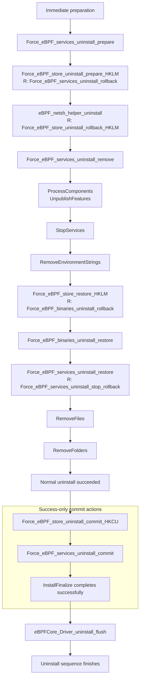
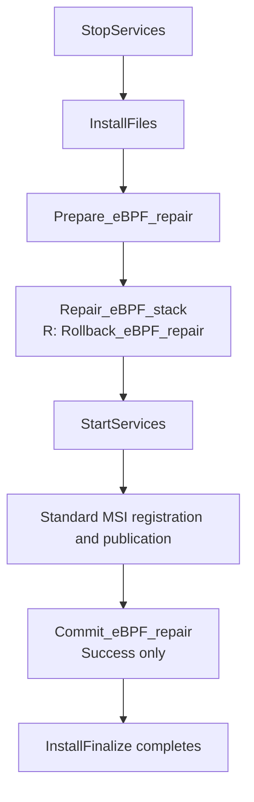

# MSI forced installation and restoration

## MSI behavior

For a new installation, if the registry search detects an existing eBPFCore service `ImagePath`,
the MSI stops unless `FORCE=1` is supplied.

Forced installation also rejects an existing `HKCU\Software\eBPF` key before installing files or
stopping services. HKCU checks, writes, and cleanup run as the installing user, not as SYSTEM.

With `FORCE=1` and an existing eBPFCore registration, the MSI:

1. Saves the current configuration and running state of eBPFCore, NetEbpfExt, and eBPFSvc.
2. Stops NetEbpfExt, eBPFSvc, and then eBPFCore.
3. Records an existing backup name for each Windows binary, then removes each canonical name and creates its hard link directly to the new MSI binary.
4. Saves the HKLM eBPF store, then populates HKLM and the installing user's HKCU with the MSI's metadata.
5. Configures and starts the drivers, and configures and requests startup of eBPFSvc.

On final uninstall, the saved original service state, binary hard links, and HKLM store are used
to restore the machine-wide eBPF stack to its pre-MSI state. HKCU has no backups: failed forced
installation removes the newly created user store, and successful final uninstall deletes
`HKCU\Software\eBPF` during commit. HKCU cleanup is deferred until successful uninstall commit,
so no uninstall snapshot is needed.
Installation and uninstallation must run as the same user; there is no cross-user cleanup or ownership marker.

Known limitation: if eBPFSvc was running when uninstall began, Restart Manager may stop it before
the rollback snapshot. If uninstall subsequently fails, rollback may leave eBPFSvc stopped rather than
restore its running state. Start it manually if needed.

| Purpose | Filenames |
|---|---|
| Original machine store | `ebpf-store-hklm.json` `ebpf-store-hklm.reg` |
| Uninstall machine store undo | `ebpf-store-hklm.uninstall.json` `ebpf-store-hklm.uninstall.reg` |
| Original services | `ebpf-services.original.json` `<service>.original.reg` |
| Uninstall service undo | `ebpf-services.uninstall-rollback.json` `<service>.uninstall-rollback.reg` |
| Repair undo | `ebpf-repair.json` `<service>.repair.reg` |
| Original binary backup names | `ebpf-binary-links.original.json` |
| Binary repair undo | `<binary>.ebpf-msi-repair` |

### Backup directory protection

Machine backups inherit Program Files permissions: ordinary users can read but not modify them.
No per-user backup directory, SID file, or custom user-backup ACLs are created.

## 1. Install execution flow

This chart follows the successful **new-install** path, using the current compiled MSI's execution
order. It includes ordinary installation and forced stack replacement.
Action boxes contain only action names. An `R: <action>` line identifies rollback work newly registered
before that step in sequence order, since the previous executed step.

```mermaid
flowchart TD
    Prep["Immediate preparation<br/>Validate_existing_eBPF_stack [forced replacement]"]
    Allowed{"Launch conditions pass?"}
    Reject["Launch-condition failure"]
    Prep --> Allowed
    Allowed -->|No| Reject

        Stop{"Forced stack replacement?"}
        StandardStop["StopServices"]
        Files["CreateFolders<br/>InstallFiles"]
        Forced{"Existing eBPFCore and FORCE=1?"}
        Backup["Force_eBPF_services_backup"]
        NetStop["Force_NetEbpfExt_Driver_stop<br/>R: Force_eBPF_services_rollback"]
        SvcStop["Force_eBPFSvc_stop"]
        CoreStop["Force_eBPFCore_Driver_stop"]
        BinaryBackup["Force_eBPF_binaries_backup"]
        Links["Force_eBPF_binaries_hardlink<br/>R: Force_eBPF_binaries_restore"]
        MachineBackup["Force_eBPF_store_backup_HKLM"]
        ClearMachine["Clear_eBPF_store_HKLM<br/>R: Force_eBPF_store_rollback_HKLM [forced replacement]<br/>R: Rollback_eBPF_store_HKCU [forced replacement]"]
        SetupMachine["Setup_eBPF_store_HKLM"]
        ClearUser["Clear_eBPF_store_HKCU"]
        SetupUser["Setup_eBPF_store_HKCU"]
        NetshDelete["eBPF_netsh_helper_uninstall_rollback"]
        NetshAdd["eBPF_netsh_helper_install"]
        CoreExists{"eBPFCore existed before install?"}
        CoreCreate["eBPFCore_Driver_install<br/>R: eBPFCore_Driver_uninstall_rollback"]
        CoreConfigure["Force_eBPFCore_Driver_configure"]
        CoreStart["eBPFCore_Driver_start<br/>R: eBPFCore_Driver_stop_rollback"]
        NetExists{"NetEbpfExt existed before install?"}
        NetConfigure["Force_NetEbpfExt_Driver_configure"]
        NetForced{"Forced stack replacement?"}
        NetCreate["NetEbpfExt_Driver_install<br/>R: NetEbpfExt_Driver_uninstall_rollback"]
        NetForceCreate["Force_NetEbpfExt_Driver_install<br/>R: NetEbpfExt_Driver_uninstall_rollback"]
        NetStart["NetEbpfExt_Driver_start<br/>R: NetEbpfExt_Driver_stop_rollback"]
        Environment["WriteEnvironmentStrings"]
        SvcConfigure["Force_eBPFSvc_configure<br/>R: eBPFSvc_uninstall_rollback [eBPFSvc absent]<br/>R: Force_eBPFSvc_stop_rollback [forced stack replacement]"]
        SvcStart["StartServices"]
        Publish["RegisterUser<br/>RegisterProduct<br/>PublishFeatures<br/>PublishProduct"]
        NormalSuccess["Normal installation succeeded"]

        Stop -->|No| StandardStop --> Files
        Stop -->|Yes: standard StopServices skipped| Files
        Files --> Forced
        Forced -->|Yes| Backup --> NetStop --> SvcStop --> CoreStop
        CoreStop --> BinaryBackup --> Links --> MachineBackup --> ClearMachine
        Forced -->|No| ClearMachine
        ClearMachine --> SetupMachine --> ClearUser --> SetupUser
        SetupUser --> NetshDelete --> NetshAdd --> CoreExists
        CoreExists -->|No| CoreCreate --> CoreStart
        CoreExists -->|Yes: FORCE=1 required| CoreConfigure --> CoreStart
        CoreStart --> NetExists
        NetExists -->|Yes: FORCE=1 and core required| NetConfigure --> NetStart
        NetExists -->|No| NetForced
        NetForced -->|No| NetCreate --> NetStart
        NetForced -->|Yes| NetForceCreate --> NetStart
        NetStart --> Environment --> SvcConfigure --> SvcStart --> Publish --> NormalSuccess
    Allowed -->|Yes| Stop

    NormalSuccess --> Finished["InstallFinalize completes successfully"]
    Finished --> Done["Installation complete"]
```

If normal work reports a fatal error, MSI runs the rollback work accumulated so far, using the
original backups. No success-only install cleanup is needed: successful installation keeps those
backups for uninstall.
HKCU rollback simply removes the user store created by the failed forced installation.

## 2. Uninstall execution flow

This chart follows supported final removal (`REMOVE="ALL"` and `NOT UPGRADINGPRODUCTCODE`).
Rollback annotations use the same `R: <action>` convention as section 1.
`Force_eBPF_services_uninstall_remove` stops eBPFSvc, NetEbpfExt, and then eBPFCore before
removing registrations. The separate driver-stop actions apply only to upgrade removal.

If normal uninstall work reports a fatal error, MSI follows recovery rather than the success-only
cleanup path. Recovery is not expanded here; it restores the pre-uninstall state using the rollback work
accumulated so far.

The impersonated HKCU commit runs before the SYSTEM service/HKLM commit, only after normal removal
succeeds. It deletes the current user's eBPF registry store directly, without creating or restoring a backup.

## 3. Repair execution flow

Repair actions run only for an installed product with `REINSTALL` set and no `REMOVE` property.
The installed helper is available before repair preparation, even if it was initially missing.

