# MSI forced installation and restoration

These charts describe the execution flow authored in `installer\Product.wxs`.

## MSI behavior

For a new installation, if the registry search detects an existing eBPFCore service `ImagePath`,
the MSI stops unless `FORCE=1` is supplied. This checks service registration, not whether the driver
file exists or is running. With no existing core, ordinary installation does not use the forced
backup/hard-link path.

With `FORCE=1` and an existing eBPFCore registration, the MSI:

1. Saves the current configuration and running state of eBPFCore, NetEbpfExt, and eBPFSvc.
2. Stops NetEbpfExt, eBPFSvc, and then eBPFCore.
3. Preserves the existing Windows binaries through backup hard links and replaces their canonical
   Windows paths with hard links to the new MSI binaries.
4. Saves the HKLM and installing user's HKCU eBPF stores, then replaces their metadata with the MSI's version.
5. Configures and starts the drivers, and configures and requests startup of eBPFSvc.

The MSI creates backup and rollback files/links to preserve service information, binary links, and
registry stores; the distinction between these is explained below.

On final uninstall, the saved original service state, binary hard links, and registry stores are used
to restore the managed eBPF stack to its pre-MSI state. Original-state restoration and backup deletion
are skipped when an older MSI is removed as part of a major upgrade, so the newer version can retain
those backups. HKCU restoration currently requires uninstall to run as the user whose store was backed up.

### Why original backups and rollback files are separate

**Original backups** preserve the state before the first forced replacement. They survive successful
installation and subsequent replacements/upgrades, and are not overwritten when already present.
They are used on final uninstall.

**Rollback files** preserve the state immediately before the current installation attempt. If that
attempt fails, they restore the version that was working just before it. They are removed after success.
Uninstall also creates temporary rollback snapshots so a failed uninstall can recover its starting state.

For example: original Windows stack **A** is replaced by MSI version **B**, then an upgrade attempts
version **C**. The original backup must remain **A**, while this attempt's rollback snapshot must
preserve **B**. If C fails, restore **B**; on final uninstall of a successfully installed version,
restore **A**. A single overwritten backup cannot serve both purposes.

### Requirements and recovery details

New installations are rejected if NetEbpfExt's `ImagePath` is detected without an eBPFCore `ImagePath`,
even with `FORCE=1`. Maintenance and uninstall remain allowed.

Forced replacement uses NTFS hard links for six binaries under `System32` and `System32\drivers`,
and updates service registrations to those canonical Windows paths. `INSTALLFOLDER` must be on the
same volume as Windows and support hard links. Missing canonical binaries, failure to stop a service,
or failure to stage replacement links aborts replacement before any canonical link is changed.

The standard MSI service-stop action is skipped for forced stack replacement so the custom chain can
capture running states before stopping services. Normal installation, maintenance, and uninstall
retain standard service stopping. The installer temporarily grants access to protected originals and
restores their ACLs through rollback links; distinct replacement files retain their MSI-installed ACLs.

During installation rollback, stop actions precede driver configuration recovery or deletion of
MSI-created registrations. Full service recovery follows binary and store recovery. Final uninstall
stops NetEbpfExt before eBPFCore, restores pre-existing services, and removes MSI-created services.
An uninstall failure attempts to recover the pre-uninstall state.

### Backup filenames

Service and store metadata reside under `%ProgramData%\eBPF-for-Windows\MsiBackup`.
In the table, `<scope>` is `hklm` or `hkcu`, and `<service>` is eBPFCore, NetEbpfExt, or eBPFSvc.

| State | Metadata | Registry export |
|---|---|---|
| Original store | `ebpf-store-<scope>.json` | `ebpf-store-<scope>.reg` |
| Install-attempt store rollback | `ebpf-store-<scope>.rollback.json` | `ebpf-store-<scope>.rollback.reg` |
| Original services | `ebpf-services.original.json` | `<service>.original.reg` |
| Install-attempt service rollback | `ebpf-services.rollback.json` | `<service>.rollback.reg` |

Registry exports are created only for keys that existed; metadata records absent keys.
Legacy store `.pending` metadata and service `ebpf-services.pending.json` / `ebpf-services.json`
remain supported for recovery and restoration. Conflicting legacy and current metadata names are rejected.

Binary links are beside the canonical Windows files: `.ebpf-msi-new` stages replacement,
`.ebpf-msi-rollback` preserves pre-attempt state, and `.ebpf-msi-backup` preserves original state.
They are hard links to binaries, not JSON or registry exports. A partial set of the six original
binary backup links is rejected rather than restored incompletely.

## 1. Install execution flow

This chart follows the successful **new-install** path, using the current compiled MSI's execution
order. It includes ordinary installation and forced stack replacement.
Action boxes contain only action names. An `R: <action>` line identifies rollback work newly registered
before that step in sequence order, since the previous executed step.

```mermaid
flowchart TD
    Prep["Immediate preparation"]
    Allowed{"Launch conditions pass?"}
    Reject["Launch-condition failure"]
    Prep --> Allowed
    Allowed -->|No| Reject

        Stop{"Forced stack replacement?"}
        StandardStop["StopServices"]
        Files["CreateFolders<br/>InstallFiles"]
        Forced{"Existing eBPFCore and FORCE=1?"}
        Backup["Force_eBPF_services_backup<br/>R: Force_eBPF_services_rollback"]
        NetStop["Force_NetEbpfExt_Driver_stop"]
        SvcStop["Force_eBPFSvc_stop"]
        CoreStop["Force_eBPFCore_Driver_stop"]
        Links["Force_eBPF_binaries_hardlink<br/>R: Force_eBPF_binaries_restore"]
        MachineBackup["Force_eBPF_store_backup_HKLM<br/>R: Force_eBPF_store_rollback_HKLM"]
        UserBackup["Force_eBPF_store_backup_HKCU<br/>R: Force_eBPF_store_rollback_HKCU"]
        ClearMachine["Clear_eBPF_store_HKLM"]
        SetupMachine["Setup_eBPF_store_HKLM"]
        ClearUser["Clear_eBPF_store_HKCU"]
        SetupUser["Setup_eBPF_store_HKCU"]
        NetshDelete["eBPF_netsh_helper_uninstall_rollback"]
        NetshAdd["eBPF_netsh_helper_install"]
        CoreExists{"eBPFCore existed before install?"}
        CoreCreate["eBPFCore_Driver_install<br/>R: eBPFCore_Driver_uninstall_rollback"]
        CoreConfigure["Force_eBPFCore_Driver_configure"]
        CoreStart["eBPFCore_Driver_start<br/>R: eBPFCore_Driver_stop_rollback"]
        NetExists{"NetEbpfExt existed before install?"}
        NetConfigure["Force_NetEbpfExt_Driver_configure"]
        NetForced{"Forced stack replacement?"}
        NetCreate["NetEbpfExt_Driver_install<br/>R: NetEbpfExt_Driver_uninstall_rollback"]
        NetForceCreate["Force_NetEbpfExt_Driver_install<br/>R: NetEbpfExt_Driver_uninstall_rollback"]
        NetStart["NetEbpfExt_Driver_start<br/>R: NetEbpfExt_Driver_stop_rollback"]
        Environment["WriteEnvironmentStrings"]
        SvcConfigure["Force_eBPFSvc_configure<br/>R: eBPFSvc_uninstall_rollback [eBPFSvc absent]<br/>R: Force_eBPFSvc_stop_rollback [forced stack replacement]"]
        SvcStart["StartServices"]
        Publish["RegisterUser<br/>RegisterProduct<br/>PublishFeatures<br/>PublishProduct"]
        NormalSuccess["Normal installation succeeded"]

        Stop -->|No| StandardStop --> Files
        Stop -->|Yes: standard StopServices skipped| Files
        Files --> Forced
        Forced -->|Yes| Backup --> NetStop --> SvcStop --> CoreStop
        CoreStop --> Links --> MachineBackup --> UserBackup --> ClearMachine
        Forced -->|No| ClearMachine
        ClearMachine --> SetupMachine --> ClearUser --> SetupUser
        SetupUser --> NetshDelete --> NetshAdd --> CoreExists
        CoreExists -->|No| CoreCreate --> CoreStart
        CoreExists -->|Yes: FORCE=1 required| CoreConfigure --> CoreStart
        CoreStart --> NetExists
        NetExists -->|Yes: FORCE=1 and core required| NetConfigure --> NetStart
        NetExists -->|No| NetForced
        NetForced -->|No| NetCreate --> NetStart
        NetForced -->|Yes| NetForceCreate --> NetStart
        NetStart --> Environment --> SvcConfigure --> SvcStart --> Publish --> NormalSuccess
    Allowed -->|Yes| Stop

    subgraph Commit["Success-only commit actions"]
        CommitForced{"Forced stack replacement?"}
        BinaryCleanup["Force_eBPF_binaries_cleanup"]
        StoreCleanup["Force_eBPF_store_commit"]
        ServiceCleanup["Force_eBPF_services_commit"]
        Finished["InstallFinalize completes successfully"]
        CommitForced -->|Yes| BinaryCleanup --> StoreCleanup --> ServiceCleanup --> Finished
        CommitForced -->|No: no forced-install commit work| Finished
    end

    NormalSuccess --> CommitForced
    Finished --> Done["Installation complete"]
```

If normal work reports a fatal error, execution leaves the success path and MSI runs the rollback
work accumulated so far; it does **not** enter the commit area.
The three commit actions execute in this order: binary cleanup, store cleanup, service cleanup.
Their execution is **after all normal work above**, even though their scheduling entries appear
much earlier in the MSI sequence.

## 2. Uninstall execution only: when the work actually happens

This chart follows successful full removal (`REMOVE="ALL"`), including the conditional path used when
a major upgrade removes an older product.

```mermaid
flowchart TD
    Prep["Immediate preparation"]

        FinalRemoval{"Final removal?<br/>NOT UPGRADINGPRODUCTCODE"}
        ServiceSnapshot["Force_eBPF_services_uninstall_prepare"]
        MachineSnapshot["Force_eBPF_store_uninstall_prepare_HKLM<br/>R: Force_eBPF_services_uninstall_rollback"]
        UserSnapshot["Force_eBPF_store_uninstall_prepare_HKCU<br/>R: Force_eBPF_store_uninstall_rollback_HKLM"]
        Netsh["eBPF_netsh_helper_uninstall<br/>R: Force_eBPF_store_uninstall_rollback_HKCU [final removal]"]
        CoreStop["eBPFCore_Driver_stop"]
        NetStop["NetEbpfExt_Driver_stop"]
        RemoveCreated{"Final removal?"}
        ServiceRemove["Force_eBPF_services_uninstall_remove"]
        Components["ProcessComponents<br/>UnpublishFeatures"]
        StandardStop["StopServices"]
        Environment["RemoveEnvironmentStrings"]
        RestoreOriginal{"Final removal?"}
        MachineRestore["Force_eBPF_store_restore_HKLM<br/>R: Force_eBPF_binaries_uninstall_rollback"]
        UserRestore["Force_eBPF_store_restore_HKCU"]
        BinaryRestore["Force_eBPF_binaries_uninstall_restore"]
        ServiceRestore["Force_eBPF_services_uninstall_restore"]
        Files["RemoveFiles"]
        Folders["RemoveFolders"]
        NormalSuccess["Normal uninstall succeeded"]

        FinalRemoval -->|Yes| ServiceSnapshot --> MachineSnapshot --> UserSnapshot --> Netsh
        FinalRemoval -->|No: old-product removal during upgrade| Netsh
        Netsh --> NetStop --> CoreStop --> RemoveCreated
        RemoveCreated -->|Yes| ServiceRemove --> Components
        RemoveCreated -->|No| Components
        Components --> StandardStop --> Environment --> RestoreOriginal
        RestoreOriginal -->|Yes| MachineRestore --> UserRestore --> BinaryRestore --> ServiceRestore --> Files
        RestoreOriginal -->|No: preserve original-state backups| Files
        Files --> Folders --> NormalSuccess
    Prep --> FinalRemoval

    subgraph Commit["Success-only commit actions"]
        CleanupRequired{"Final removal?"}
        MachineCleanup["Force_eBPF_store_uninstall_commit_HKLM"]
        UserCleanup["Force_eBPF_store_uninstall_commit_HKCU"]
        ServiceCleanup["Force_eBPF_services_uninstall_commit"]
        Finished["InstallFinalize completes successfully"]
        CleanupRequired -->|Yes| MachineCleanup --> UserCleanup --> ServiceCleanup --> Finished
        CleanupRequired -->|No: preserve durable backups for newer product| Finished
    end

    NormalSuccess --> CleanupRequired
    Finished --> Query["eBPFCore_Driver_uninstall_flush"]
    Query --> Done["Uninstall sequence finishes"]
```

Rollback annotations use the same `R: <action>` convention as section 1.

This preserves the **current compiled order**: NetEbpfExt is stopped before eBPFCore. Custom driver stops
and MSI-created service removal precede standard `StopServices`. Missing-service errors on the two explicit
driver stops are ignored, as authored.

If normal uninstall work reports a fatal error, MSI follows recovery rather than the success-only
cleanup path. Recovery is not expanded here; it restores the pre-uninstall state using the rollback work
accumulated so far.

The three uninstall commit actions execute only after normal removal succeeds. Unlike installation
commit cleanup, final-uninstall cleanup deletes durable original-state backups as well as temporary
recovery files.