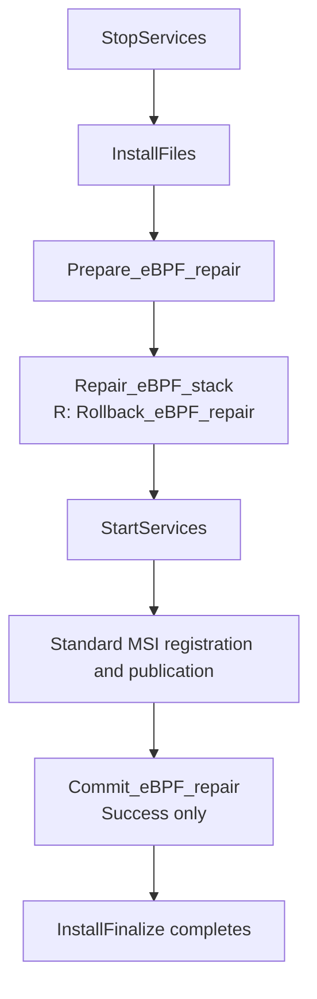

# MSI forced installation and restoration

## MSI behavior

For a new installation, if the registry search detects an existing eBPFCore service `ImagePath`,
the MSI stops unless `FORCE=1` is supplied.

With `FORCE=1` and an existing eBPFCore registration, the MSI:

1. Saves the current configuration and running state of eBPFCore, NetEbpfExt, and eBPFSvc.
2. Stops NetEbpfExt, eBPFSvc, and then eBPFCore.
3. Preserves the existing Windows binaries through backup hard links and replaces their canonical
   Windows paths with hard links to the new MSI binaries.
4. Saves the HKLM and installing user's HKCU eBPF stores, then replaces their metadata with the MSI's version.
5. Configures and starts the drivers, and configures and requests startup of eBPFSvc.

On final uninstall, the saved original service state, binary hard links, and HKLM store are used
to restore the machine-wide eBPF stack to its pre-MSI state. HKCU restoration is best effort by identity:
only the saved installing user restores their HKCU store. Another user or SYSTEM skips that restoration
with a warning, leaves the caller's HKCU unchanged, and retains the original HKCU backup.

Known limitation: if eBPFSvc was running when uninstall began, Restart Manager may stop it before
the rollback snapshot. If uninstall subsequently fails, rollback may leave eBPFSvc stopped rather than
restore its running state. Start it manually if needed.

### Backup filenames

Machine metadata lives in native `%ProgramFiles%\ebpf-for-windows\MsiBackup`, regardless of
`INSTALLFOLDER`; HKCU metadata lives in `UserStore` beneath it. Binary links sit beside the canonical
Windows binaries. Below, `<scope>` is `hklm` or `hkcu`, `<service>` is eBPFCore, NetEbpfExt, or eBPFSvc,
and `<binary>` is the canonical binary filename. Registry exports exist only for keys that were present.
Uninstall preparation requires either no service snapshot and no binary backups, or a valid service
snapshot and all six binary backups. Mismatches are rejected without deleting remaining backups.

| Purpose | Filenames |
|---|---|
| Original store | `ebpf-store-<scope>.json` `ebpf-store-<scope>.reg` |
| Uninstall store undo | `ebpf-store-<scope>.uninstall.json` `ebpf-store-<scope>.uninstall.reg` |
| Original services | `ebpf-services.original.json` `<service>.original.reg` |
| Uninstall service undo | `ebpf-services.uninstall-rollback.json` `<service>.uninstall-rollback.reg` |
| Repair undo | `ebpf-repair.json` `<service>.repair.reg` |
| Original binary | `<binary>.ebpf-msi-backup` |
| Staged replacement | `<binary>.ebpf-msi-new` |
| Binary repair undo | `<binary>.ebpf-msi-repair` |

### Backup directory protection

Machine backups inherit Program Files permissions: ordinary users can read but not modify them.
Only `UserStore` and its protected owner marker receive custom ACLs. The installing user can create,
modify, and delete backup files, but cannot rename, delete, or change permissions on `UserStore` itself
or create subdirectories. SYSTEM stages the owner marker, grants user access, then finalizes
`hkcu-owner.sid`. HKCU actions run as that user; other identities skip them without loading another
profile.
These actions back up, clear, populate, and restore the user's eBPF registry store, and clean up its backup files.

## 1. Install execution flow

This chart follows the successful **new-install** path, using the current compiled MSI's execution
order. It includes ordinary installation and forced stack replacement.
Action boxes contain only action names. An `R: <action>` line identifies rollback work newly registered
before that step in sequence order, since the previous executed step.

```mermaid
flowchart TD
    Prep["Immediate preparation"]
    Allowed{"Launch conditions pass?"}
    Reject["Launch-condition failure"]
    Prep --> Allowed
    Allowed -->|No| Reject

        Stop{"Forced stack replacement?"}
        StandardStop["StopServices"]
        Files["CreateFolders<br/>InstallFiles"]
        UserAccess["Prepare_eBPF_user_store<br/>R: Rollback_eBPF_user_store"]
        Forced{"Existing eBPFCore and FORCE=1?"}
        Backup["Force_eBPF_services_backup"]
        NetStop["Force_NetEbpfExt_Driver_stop<br/>R: Force_eBPF_services_rollback"]
        SvcStop["Force_eBPFSvc_stop"]
        CoreStop["Force_eBPFCore_Driver_stop"]
        BinaryBackup["Force_eBPF_binaries_backup"]
        Links["Force_eBPF_binaries_hardlink<br/>R: Force_eBPF_binaries_restore"]
        MachineBackup["Force_eBPF_store_backup_HKLM"]
        UserBackup["Force_eBPF_store_backup_HKCU<br/>R: Force_eBPF_store_rollback_HKLM"]
        ClearMachine["Clear_eBPF_store_HKLM<br/>R: Force_eBPF_store_rollback_HKCU [forced replacement]"]
        SetupMachine["Setup_eBPF_store_HKLM"]
        ClearUser["Clear_eBPF_store_HKCU"]
        SetupUser["Setup_eBPF_store_HKCU"]
        NetshDelete["eBPF_netsh_helper_uninstall_rollback"]
        NetshAdd["eBPF_netsh_helper_install"]
        CoreExists{"eBPFCore existed before install?"}
        CoreCreate["eBPFCore_Driver_install<br/>R: eBPFCore_Driver_uninstall_rollback"]
        CoreConfigure["Force_eBPFCore_Driver_configure"]
        CoreStart["eBPFCore_Driver_start<br/>R: eBPFCore_Driver_stop_rollback"]
        NetExists{"NetEbpfExt existed before install?"}
        NetConfigure["Force_NetEbpfExt_Driver_configure"]
        NetForced{"Forced stack replacement?"}
        NetCreate["NetEbpfExt_Driver_install<br/>R: NetEbpfExt_Driver_uninstall_rollback"]
        NetForceCreate["Force_NetEbpfExt_Driver_install<br/>R: NetEbpfExt_Driver_uninstall_rollback"]
        NetStart["NetEbpfExt_Driver_start<br/>R: NetEbpfExt_Driver_stop_rollback"]
        Environment["WriteEnvironmentStrings"]
        SvcConfigure["Force_eBPFSvc_configure<br/>R: eBPFSvc_uninstall_rollback [eBPFSvc absent]<br/>R: Force_eBPFSvc_stop_rollback [forced stack replacement]"]
        SvcStart["StartServices"]
        Publish["RegisterUser<br/>RegisterProduct<br/>PublishFeatures<br/>PublishProduct"]
        NormalSuccess["Normal installation succeeded"]

        Stop -->|No| StandardStop --> Files
        Stop -->|Yes: standard StopServices skipped| Files
        Files --> UserAccess --> Forced
        Forced -->|Yes| Backup --> NetStop --> SvcStop --> CoreStop
        CoreStop --> BinaryBackup --> Links --> MachineBackup --> UserBackup --> ClearMachine
        Forced -->|No| ClearMachine
        ClearMachine --> SetupMachine --> ClearUser --> SetupUser
        SetupUser --> NetshDelete --> NetshAdd --> CoreExists
        CoreExists -->|No| CoreCreate --> CoreStart
        CoreExists -->|Yes: FORCE=1 required| CoreConfigure --> CoreStart
        CoreStart --> NetExists
        NetExists -->|Yes: FORCE=1 and core required| NetConfigure --> NetStart
        NetExists -->|No| NetForced
        NetForced -->|No| NetCreate --> NetStart
        NetForced -->|Yes| NetForceCreate --> NetStart
        NetStart --> Environment --> SvcConfigure --> SvcStart --> Publish --> NormalSuccess
    Allowed -->|Yes| Stop

    NormalSuccess --> Finished["InstallFinalize completes successfully"]
    Finished --> Done["Installation complete"]
```

If normal work reports a fatal error, MSI runs the rollback work accumulated so far, using the
original backups. No success-only install cleanup is needed: successful installation keeps those
backups for uninstall.
After HKCU rollback, SYSTEM removes an empty `UserStore` and its owner marker, including pre-existing
empty metadata. If backup files remain, both the directory and marker are retained for recovery.

## 2. Uninstall execution flow

This chart follows supported final removal (`REMOVE="ALL"` and `NOT UPGRADINGPRODUCTCODE`).
Rollback annotations use the same `R: <action>` convention as section 1.
`Force_eBPF_services_uninstall_remove` stops eBPFSvc, NetEbpfExt, and then eBPFCore before
removing registrations. The separate driver-stop actions apply only to upgrade removal.

```mermaid
flowchart TD
    Prep["Immediate preparation"]

        UserAccess["Prepare_eBPF_user_store_uninstall"]
        ServiceSnapshot["Force_eBPF_services_uninstall_prepare"]
        MachineSnapshot["Force_eBPF_store_uninstall_prepare_HKLM<br/>R: Force_eBPF_services_uninstall_rollback"]
        UserSnapshot["Force_eBPF_store_uninstall_prepare_HKCU<br/>R: Force_eBPF_store_uninstall_rollback_HKLM"]
        Netsh["eBPF_netsh_helper_uninstall<br/>R: Force_eBPF_store_uninstall_rollback_HKCU"]
        ServiceRemove["Force_eBPF_services_uninstall_remove"]
        Components["ProcessComponents<br/>UnpublishFeatures"]
        StandardStop["StopServices"]
        Environment["RemoveEnvironmentStrings"]
        MachineRestore["Force_eBPF_store_restore_HKLM<br/>R: Force_eBPF_binaries_uninstall_rollback"]
        UserRestore["Force_eBPF_store_restore_HKCU"]
        BinaryRestore["Force_eBPF_binaries_uninstall_restore"]
        ServiceRestore["Force_eBPF_services_uninstall_restore<br/>R: Force_eBPF_services_uninstall_stop_rollback"]
        Files["RemoveFiles"]
        Folders["RemoveFolders"]
        NormalSuccess["Normal uninstall succeeded"]

        UserAccess --> ServiceSnapshot --> MachineSnapshot --> UserSnapshot --> Netsh
        Netsh --> ServiceRemove --> Components
        Components --> StandardStop --> Environment --> MachineRestore
        MachineRestore --> UserRestore --> BinaryRestore --> ServiceRestore --> Files
        Files --> Folders --> NormalSuccess
    Prep --> UserAccess

    subgraph Commit["Success-only commit actions"]
        UserCleanup["Force_eBPF_store_uninstall_commit_HKCU"]
        ServiceCleanup["Force_eBPF_services_uninstall_commit"]
        Finished["InstallFinalize completes successfully"]
        UserCleanup --> ServiceCleanup --> Finished
    end

    NormalSuccess --> UserCleanup
    Finished --> Query["eBPFCore_Driver_uninstall_flush"]
    Query --> Done["Uninstall sequence finishes"]
```

If normal uninstall work reports a fatal error, MSI follows recovery rather than the success-only
cleanup path. Recovery is not expanded here; it restores the pre-uninstall state using the rollback work
accumulated so far.

The impersonated HKCU commit runs before the SYSTEM service/HKLM commit, only after normal removal
succeeds. It deletes restored original-state backups and temporary uninstall recovery files;
skipped HKCU backups remain.

## 3. Repair execution flow

Repair actions run only for an installed product with `REINSTALL` set and no `REMOVE` property.
The installed helper is available before repair preparation, even if it was initially missing.

